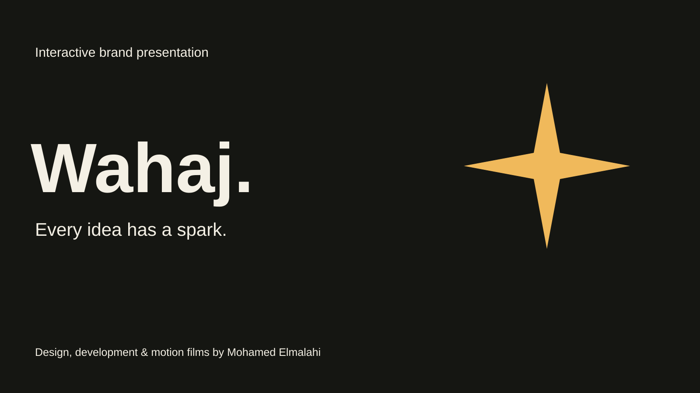

# Wahaj — Interactive Brand Presentation

**Designed, developed and produced end to end by Mohamed Elmalahi.**



[Live presentation](https://wahaj-team-presentation.peachypearl17.chatgpt.site/english/index.html) · [My portfolio](https://mohamed-creative-portfolio.peachypearl17.chatgpt.site)

A 29-slide interactive brand presentation connecting Wahaj’s creative identity with A2Z Academy’s practical learning story. The professional English edition preserves the original design, graphics, animation and embedded films, while removing personal photographs and internal humor.

## My role

I designed and developed the complete presentation, including its visual language, narrative structure, animations, interactive controls, sound design and embedded video production. I led the project from concept to delivery through AI-assisted creative tools, code and iterative refinement.

## Experience

- 29 English slides with progressive content reveals.
- Original animated illustrations, themed chapters and motion graphics.
- Two original MP4 films with automatically displayed English subtitles below the player.
- Original video content preserved; translations are separate subtitle tracks, not burned into the films.
- Chapter navigation, keyboard shortcuts, touch gestures and fullscreen video.
- Prominent optional transition sound effects, with no background music.
- Reduced-motion support and accessible controls.
- No backend, account or tracking.

## Run locally

```bash
python3 tools/download_assets.py
python3 -m http.server 8000
```

Open **http://localhost:8000**. Python 3 is the only setup requirement. The downloader uses the standard library and verifies every original media file against its recorded SHA-256. Large media files are hosted separately to keep this source repository small; their URLs and hashes are in `media-manifest.json`.

After downloading the assets, the presentation also opens directly from `index.html`. The custom subtitle strip works without a server; native VTT tracks work best over HTTP.

## Controls

| Action | Control |
| --- | --- |
| Reveal next point or slide | Next / Right / Space / Page Down |
| Go back | Back / Left / Page Up |
| First or last slide | Home / End |
| Fullscreen | Fullscreen button / F |
| Chapter navigation | Contents |
| Close a dialog | Escape |
| Mute page audio | Sound control |

Media and transition sound require a user gesture. Touch devices support visible controls and horizontal swipe navigation.

## Source map

| File | Purpose |
| --- | --- |
| `index.html` | Original slide structure, English content and navigation |
| `deck-refresh.css` | Established responsive visual system |
| `english.css` | English layout fixes and subtitle layout |
| `deck-motion.js` | Original per-slide animation behavior |
| `deck-effects-only.js` | Web Audio transition sound |
| `intro-player.js` | Introduction film controls |
| `captions.js` / `captions.json` | Automatic time-coded English subtitle strips |
| `assets/*.vtt` | Native subtitle tracks |
| `media-manifest.json` | Original media URLs and SHA-256 hashes |
| `tools/download_assets.py` | Verified, dependency-free media setup |

The SVG cover is designed project artwork, not a browser screenshot.

## Validation

JavaScript syntax, local references, all subtitle cues and native-player mode changes were checked. Original MP4 and animation JS/CSS were compared byte for byte. The English layout repair separates the team-introduction spark from its heading without changing animation timings.

Live-browser and physical-device verification are not claimed by these source checks. Native fullscreen and audio behavior depend on browser support and user settings.

## Context

Independent team project and portfolio adaptation. A2Z is the presentation subject; this project does not imply an official commission, partnership or endorsement. Offer examples are historical, dated September and October 2026, and are not guarantees of current availability.

Copyright © 2026 Mohamed Elmalahi. Third-party names and marks remain the property of their owners.
